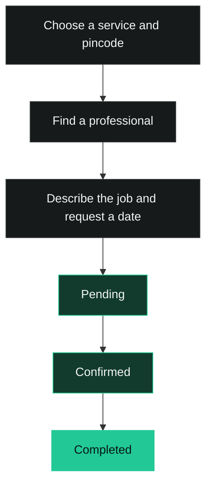

<p align="center">
  
</p>

<p align="center">Good help. Close to home. Consider it doable.</p>

<p align="center">
  <a href="#how-it-works">How it works</a> ·
  <a href="#quick-start">Quick start</a> ·
  <a href="#features">Features</a> ·
  <a href="#development">Development</a> ·
  <a href="https://github.com/kishan3113/Doable/issues">Report an issue</a>
</p>

<p align="center">
  
  
  
  
</p>

---

**Doable connects customers with local service professionals and keeps job requests in one place.** Find a professional by service and pincode, describe the work, request a date, and follow its status. Professionals manage their profiles, incoming requests, and unavailable dates.



## Contents

- [Why Doable](#why-doable)
- [How it works](#how-it-works)
- [Features](#features)
- [Quick start](#quick-start)
- [Local demo](#local-demo)
- [Project layout](#project-layout)
- [Development](#development)
- [Status and limitations](#status-and-limitations)

## Why Doable

Everyday jobs should be easier to organize. Doable brings service discovery, job details, scheduling requests, and status tracking into a shared website for customers and professionals.

Supported services: **Plumbing, electrical work, carpentry, painting, mechanical work, cleaning, and gardening.**

## How it works

| Step | Customer | Professional |
| --- | --- | --- |
| Discover | Search by service and six-digit pincode; view a professional's details. | Create a profile with service and contact information. |
| Request | Sign in, describe the job, choose a date, and optionally attach photos or location. | Review incoming requests and job information. |
| Manage | Follow the tracking code or open booking history. | Confirm requests, update status, and block unavailable dates. |

## Features

- **Public website:** service search, category cards, professional profiles, booking explanation, and FAQ.
- **Customer workspace:** profile editing, professional search, booking requests, photo attachments, optional location sharing, tracking, and history.
- **Professional workspace:** profile/photo editing, searchable and filterable requests, sorting, pagination, status updates, finished-request hiding, and availability calendar.
- **Responsive interface:** shared charcoal/mint styling, labelled forms, keyboard focus indicators, inline feedback, and in-page confirmations.
- **Development demos:** one-click customer and professional sessions backed by local browser storage.

## Quick start

Requirements: Git, Node.js, and npm. MongoDB is needed only when running your own backend.

```bash
git clone https://github.com/kishan3113/Doable.git
cd Doable
npm ci --prefix client
npm start --prefix client
```

Open **http://localhost:3000**.

The client currently targets the existing hosted API at `https://doable-ojum.onrender.com`. Starting a local server does not automatically connect the client to it. Normal account operations use that hosted service; use the local demos to explore with sample data.

### Run your own backend

```bash
npm ci --prefix server
```

Create an ignored `server/.env`:

```dotenv
MONGO_URI=mongodb://127.0.0.1:27017/doable
PORT=3001
```

Then start the API:

```bash
cd server
node server.js
```

To connect the frontend, replace its hosted API base URLs with your local API URL. Use a development database. The optional transaction-based booking endpoint requires a MongoDB replica set.

## Local demo

1. Start the frontend in development mode.
2. Open `/login` and choose **Try customer demo** or **Try worker demo**.
3. Search for **Plumber** in **110001** to find the sample professional.
4. Explore requests, tracking, status changes, and date blocking across both roles.

No credentials are required. Demo requests are intercepted locally and sample changes stay in the browser. Password changes and professional photo uploads are unavailable in demo mode. Demo shortcuts are omitted from production builds.

## Project layout

```text
client/
  public/          Static assets, logo, and licensed service photos
  src/             Public pages, account forms, dashboards, shared UI
    App.js         Website routes
    App.test.js    Integration tests
    demoApi.js     Browser-only demo adapter
    website.css    Shared visual system and responsive layouts
server/
  server.js        Express API, Mongoose models, and upload handling
  uploads/         Uploaded media
  migrate_bookings.js
```

Service-photo sources and license links are recorded in [`sources.json`](client/public/images/stock/sources.json).

## Development

Run these commands from the repository root:

```bash
# Run frontend integration tests once
CI=true npm test --prefix client -- --watchAll=false --runInBand

# Create the production frontend bundle
npm run build --prefix client
```

Tests use Jest and React Testing Library with mocked API calls. Coverage includes service search, account handoffs, booking feedback, status updates, and demo limitations. The backend currently has no automated test suite; its `npm test` script is a placeholder.

## Status and limitations

Doable is **in development**. The UI has been reviewed, but production readiness still requires server-side authentication, ownership checks, upload safeguards, and more consistent booking/scheduling rules.

- Login currently does not establish a server-verifiable session.
- The main booking flow requests a date; time-slot scheduling is not integrated into the active interface.
- Payments, pricing, reviews, provider verification, chat, notifications, and customer rescheduling/cancellation are not implemented.
- Discuss service scope, price, and payment directly with the professional.
