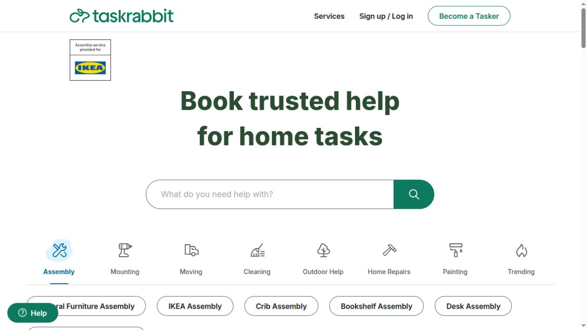
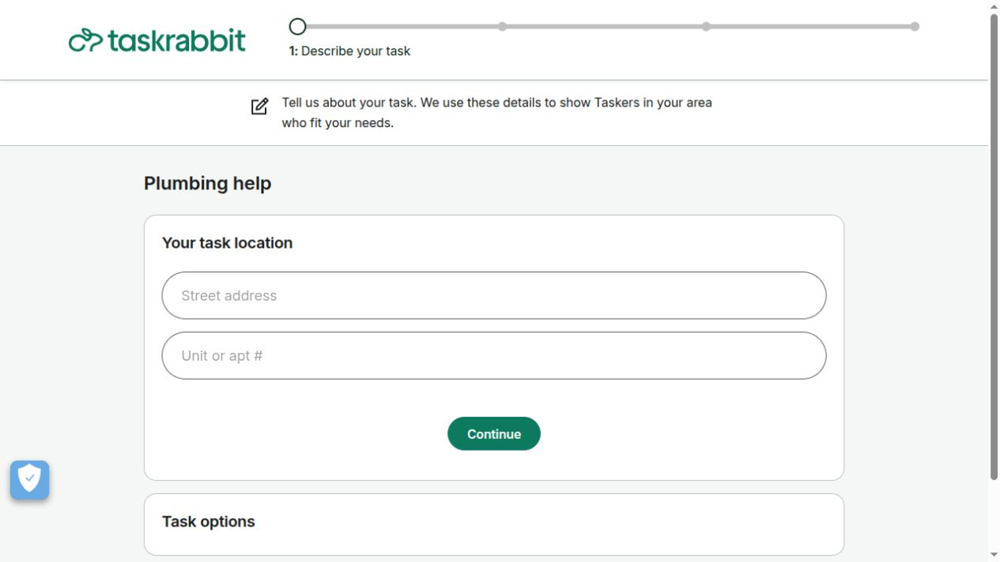
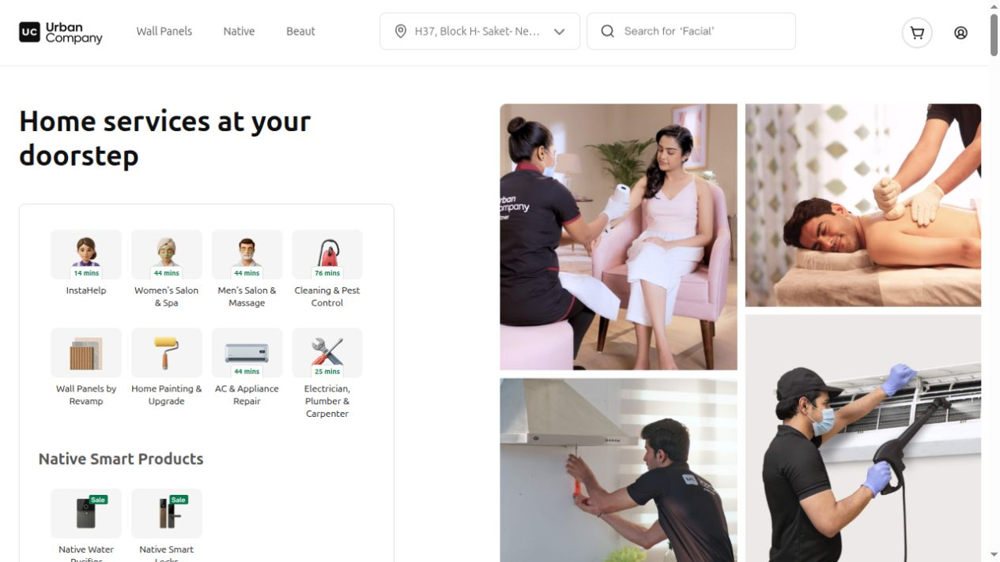
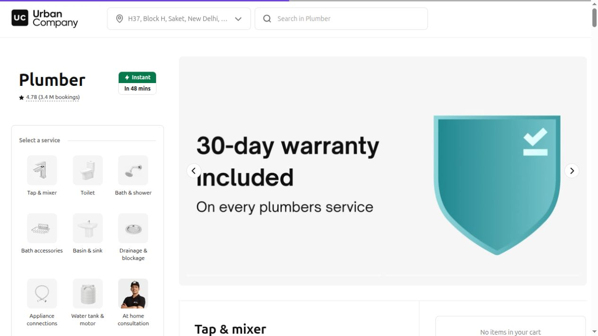
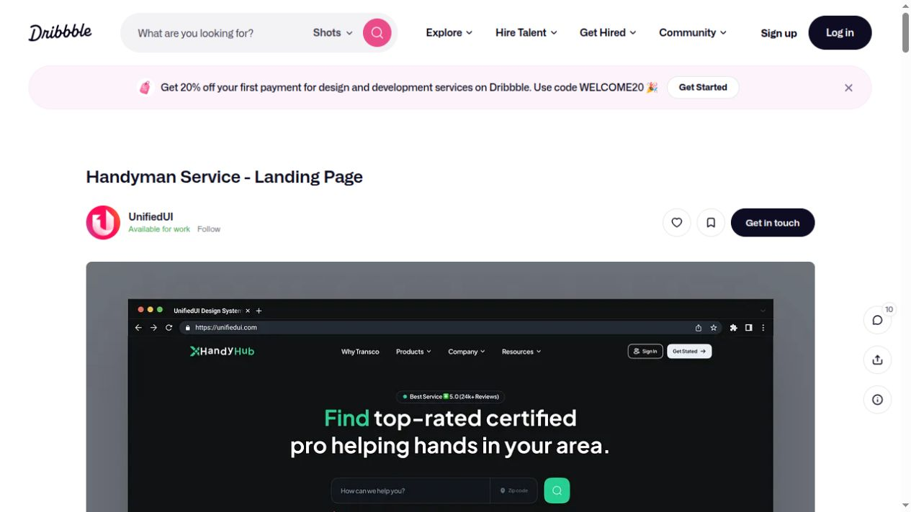

# Doable — UI Reference Research

Reviewed 13 October 2026. This is a design study, not an implementation or a product endorsement.

## Recommended direction

Build a welcoming local-services marketplace with a search-led landing page, browsable service categories, individual professional profiles, and a guided booking flow. My recommendation combines Taskrabbit's marketplace journey with Urban Company's catalogue organization and selected visual ideas from independent design concepts. These are interpretations for Doable, not statements that the reference products share our exact model.

Use warm off-white surfaces, dark navy text, teal actions, authentic service photography, consistent line icons, generous spacing, and restrained borders/shadows. Keep customer and worker experiences within one design system. Reserve stronger backgrounds for small promotional sections rather than every dashboard.

## References studied

### 1. Taskrabbit — primary marketplace reference

[Homepage](https://www.taskrabbit.com/) · [Booking entry](https://www.taskrabbit.com/book/2055/details) · [Official hiring guide](https://support.taskrabbit.com/hc/en-us/articles/46260422073755-How-Do-I-Hire-a-Tasker)

Directly inspected homepage and initial plumbing booking screen. The homepage uses a large centered heading, prominent search, green actions, category icons, task chips, project cards, and separate professional recruitment navigation. Booking exposes a progress sequence: task details, provider comparison, schedule, confirmation. The official guide describes filtering providers and reviewing skills, rates, and reviews.

**Apply to Doable:** discover services before login; make location/service search the primary action; use useful provider cards and a clear booking stepper. Keep Join as a professional separate from customer booking.

**Adapt carefully:** Doable currently lacks pricing, reviews, provider vetting, and coverage guarantees; do not import those claims as decoration.

### 2. Urban Company — catalogue and service-detail reference

[Delhi NCR homepage](https://www.urbancompany.com/delhi-ncr) · [Plumber catalogue](https://www.urbancompany.com/delhi-ncr-plumbers-density)

Directly inspected both pages. The homepage has a white layout, dark headings, top location/search controls, category tiles, a service-photo collage, and grouped discovery sections. The plumber catalogue organizes specific jobs into subcategories with service cards, details actions, prices/reviews, and a cart area.

**Apply to Doable:** recognizable service tiles; location visible throughout discovery; meaningful category and profile pages; concise service descriptions; consistent card hierarchy.

**Adapt carefully:** Urban Company's packaged service/cart approach differs from Doable's current selection of an individual worker. Keep Doable's worker identity prominent and introduce priced packages only when supported by the business model.

### 3. Thumbtack — project-search wording and discovery

[Homepage](https://www.thumbtack.com/)

Search-indexed homepage content presents project/problem description as the entry point, a Find a pro action, service discovery, and trust information. Direct browsing returned an unsupported-country message, so its current full homepage styling and booking flow were not visually verified here.

**Apply to Doable:** let customers express the job they need, then narrow by service and pincode. Keep search wording concrete and reassuring.

**Evidence limit:** use as a content/structure reference based on retrieved public content, not a verified visual benchmark.

### 4. Airtasker — two-sided marketplace communication

[Australian homepage](https://www.airtasker.com/au/)

Retrieved public page content distinguishes posting a task from earning as a provider, explains a description/budget/quotes flow, and includes service categories and provider information. Direct browser access displayed a verification page; no challenge was bypassed and no live visual layout was asserted.

**Apply to Doable:** explain the value for both customers and workers; give professionals a dedicated recruitment page and clear onboarding action.

**Adapt carefully:** the quote/bidding model differs from direct worker booking. Use the communication structure without introducing a second booking model accidentally.

### 5. UnifiedUI — Handyman Service landing-page concept

[Design reference](https://dribbble.com/shots/25402398-Handyman-Service-Landing-Page)

Directly inspected the concept artwork on Dribbble. The visible hero uses dark surfaces, green accents, a strong headline, service/location search, and compact navigation. The project includes additional preview artwork.

**Apply to Doable:** confident typography, clear search composition, and an accent color used consistently for actions. A predominantly light Doable interface can use these ideas without adopting the dark palette.

**Evidence limit:** a concept image demonstrates composition, not working responsiveness, accessibility, or conversion performance.

### 6. Imran Jakir — Smart Home Services landing-page concept

[Design reference](https://dribbble.com/shots/27344951-Smart-Home-Services-App-Landing-Page-UI-Design)

Directly inspected the artwork on Dribbble. It uses a warm cream background, purple emphasis, prominent service imagery, device mockups, and a bold split hero.

**Apply to Doable:** warmer surfaces, human imagery, and an inviting hero composition.

**Adapt carefully:** this is app-promotion artwork. Doable's website should prioritize usable service/location search and booking over device mockups or download buttons.

## Proposed Doable page system

| Page | Layout direction | Purpose |
| --- | --- | --- |
| Landing | Compact navigation; service/pincode search; human service imagery; category grid; how it works; professional invitation; FAQ/footer | Explain the product and start discovery |
| Service/search results | Editable search summary, relevant filters, clear result count, responsive worker cards | Find and compare suitable workers |
| Worker profile | Photo/name/service/area, supported profile information, job examples if available, availability, prominent booking action | Make a confident choice |
| Booking | Details and contact → availability → review → request confirmation; visible worker/job summary | Reduce form complexity and clarify commitment |
| Customer dashboard | Upcoming requests first, status and next action, history, profile settings | Manage work without repeated tracking-ID entry |
| Worker dashboard | Incoming requests, availability, booking detail/actions, profile; responsive list/toolbar | Manage work efficiently |
| Authentication | Consistent labelled forms; clear customer/professional context; optional demo block in development | Provide account access without dominating discovery |
| Become a professional | Benefits, process, requirements, registration action | Support the supply side of the marketplace |

This page system is a proposal. A worker profile, landing page, recruitment page, and guided booking steps are not yet implemented as standalone pages in the current app.

## Practical rules for the redesign

- Keep one primary action per screen, with location and selected service visible during the journey.
- Let visitors browse before requiring authentication; introduce account access when saving/submitting requires it.
- Use real provider photos, verified facts, and genuine reviews only when available. Treat demo content explicitly as samples.
- Make form labels persistent; give every action keyboard access, visible focus, and clear loading/error feedback.
- Stack search/filter controls on small screens; avoid fixed-width toolbars and unpredictable wrapping tabs.
- Use a shared spacing/type/button/card system across public pages and dashboards.
- Add pricing, verification, guarantees, and reviews only alongside their supporting product features.
- Create original layouts and licensed/original imagery; reference sites' branding and photos are research material, not Doable assets.

## Research scope

Search and public-content retrieval covered six references. Direct visual inspection covered Taskrabbit's homepage and initial booking screen, Urban Company's city homepage and plumber catalogue, and two Dribbble concept pages. Professional comparison steps behind location/account prerequisites and authenticated dashboards were not reviewed. No account, booking, payment, or email submission was made.

Saved viewport screenshots reside in `ui-references/2026-10-13/`. Some reference pages personalize by location and change over time; these captures document what was visible during this session.
